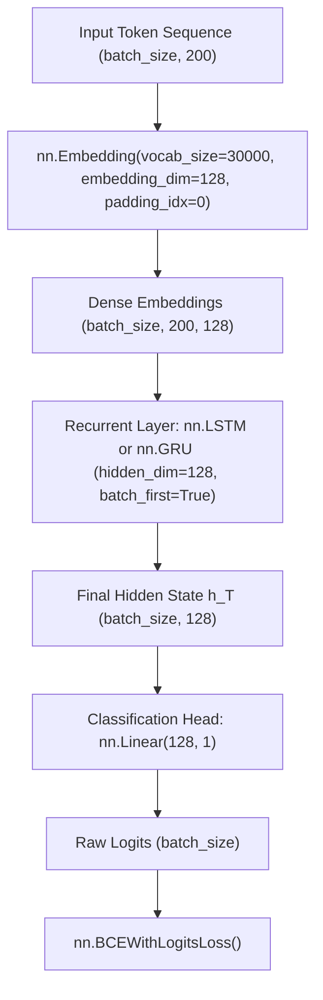

# Model Architecture — LSTM vs. GRU

This document provides a comprehensive technical and mathematical explanation of the two recurrent neural network architectures compared in this project: **Long Short-Term Memory (LSTM)** and **Gated Recurrent Unit (GRU)**.

---

## 1. High-Level Architecture Overview

Both classifiers follow an identical macro-architecture to ensure an unbiased, direct comparison:

---

## 2. Common Components

### Embedding Layer (`nn.Embedding`)
- **Vocabulary Size ($V$)**: `30,000`
- **Embedding Dimension ($D$)**: `128`
- **Padding Index**: `0` (`<PAD>`)
- **Function**: Converts discrete integer indices $x_t \in \{0, \dots, V-1\}$ into continuous dense vector representations $e_t \in \mathbb{R}^{128}$.
- **Gradient Behavior**: For tokens with index 0 (`<PAD>`), the embedding vector is initialized to zeros and gradients are not propagated, preserving a zero representation.
- **Trainable Parameters**:
  $$P_{\text{embed}} = V \times D = 30{,}000 \times 128 = 3{,}840{,}000$$

### Classification Head (`nn.Linear`)
- **Input Dimension**: `128` (final hidden state $h_T$ of the sequence).
- **Output Dimension**: `1` (single raw logit).
- **Bias**: Enabled (`bias=True`).
- **Trainable Parameters**:
  $$P_{\text{linear}} = (D_{\text{in}} \times D_{\text{out}}) + D_{\text{out}} = (128 \times 1) + 1 = 129$$

### Loss Function
- **PyTorch Criterion**: `nn.BCEWithLogitsLoss()`
- **Mathematical Formulation**:
  $$\mathcal{L} = -\frac{1}{N} \sum_{i=1}^N \left[ y_i \log \sigma(z_i) + (1 - y_i) \log(1 - \sigma(z_i)) \right]$$
  where $z_i$ is the unnormalized logit output of `fc`, $y_i \in \{0.0, 1.0\}$ is the ground-truth target, and $\sigma(z) = \frac{1}{1 + e^{-z}}$.
- **Numerical Advantage**: Combines the Sigmoid layer and Binary Cross-Entropy loss into a single operation using the log-sum-exp trick to prevent numerical instability (overflow/underflow in extreme logit ranges).

---

## 3. Long Short-Term Memory (LSTM) Architecture

### Intuition (Beginner-Friendly)
Standard RNNs struggle with long-range dependencies due to vanishing gradients. An LSTM solves this by maintaining a dedicated **Cell State** ($c_t$)—an internal "conveyor belt" of memory—regulated by three specialized gates:
1. **Forget Gate ($f_t$)**: Decides what percentage of the previous cell state to discard.
2. **Input Gate ($i_t$)**: Decides which new candidate values will update the cell state.
3. **Output Gate ($o_t$)**: Decides what part of the internal cell state will be exposed as the visible hidden state ($h_t$).

### Mathematical Equations
For input vector $x_t \in \mathbb{R}^{128}$ and previous hidden state $h_{t-1} \in \mathbb{R}^{128}$:

$$f_t = \sigma(W_{xf} x_t + W_{hf} h_{t-1} + b_f) \quad \text{(Forget Gate)}$$
$$i_t = \sigma(W_{xi} x_t + W_{hi} h_{t-1} + b_i) \quad \text{(Input Gate)}$$
$$\tilde{c}_t = \tanh(W_{xc} x_t + W_{hc} h_{t-1} + b_c) \quad \text{(Candidate Cell State)}$$
$$c_t = f_t \odot c_{t-1} + i_t \odot \tilde{c}_t \quad \text{(Cell State Update)}$$
$$o_t = \sigma(W_{xo} x_t + W_{ho} h_{t-1} + b_o) \quad \text{(Output Gate)}$$
$$h_t = o_t \odot \tanh(c_t) \quad \text{(Hidden State)}$$

where $\sigma$ denotes the sigmoid activation, $\odot$ represents element-wise multiplication, and $W \in \mathbb{R}^{128 \times 128}, b \in \mathbb{R}^{128}$.

### LSTM Parameter Count Derivation
The PyTorch `nn.LSTM(input_size=128, hidden_size=128, batch_first=True)` module has 4 internal gate transformations ($f, i, c, o$), each containing input weights, hidden weights, and two bias vectors:
- Input weights: $4 \times (128 \times 128) = 65{,}536$
- Hidden weights: $4 \times (128 \times 128) = 65{,}536$
- Biases (`bias_ih` + `bias_hh`): $4 \times 128 + 4 \times 128 = 1{,}024$
- **Total LSTM Layer Parameters**:
  $$P_{\text{LSTM}} = 4 \times (128 \times 128 + 128 \times 128 + 128 + 128) = 4 \times 33{,}024 = 132{,}096$$

- **Total SentimentLSTM Model Parameters**:
  $$P_{\text{total(LSTM)}} = P_{\text{embed}} + P_{\text{LSTM}} + P_{\text{linear}} = 3{,}840{,}000 + 132{,}096 + 129 = \mathbf{3{,}972{,}225}$$

---

## 4. Gated Recurrent Unit (GRU) Architecture

### Intuition (Beginner-Friendly)
Proposed by Cho et al. (2014), the GRU simplifies the LSTM by merging the cell state and hidden state into a single vector ($h_t$) and reducing the number of gates from three to two:
1. **Reset Gate ($r_t$)**: Decides how much of past information to forget when computing the new candidate state.
2. **Update Gate ($z_t$)**: Acts simultaneously as forget and input gates, balancing between previous state $h_{t-1}$ and new candidate state $\tilde{h}_t$.

Because it has fewer gates and no separate cell state, the GRU is computationally lighter and trains faster.

### Mathematical Equations
For input vector $x_t \in \mathbb{R}^{128}$ and previous hidden state $h_{t-1} \in \mathbb{R}^{128}$:

$$r_t = \sigma(W_{xr} x_t + W_{hr} h_{t-1} + b_r) \quad \text{(Reset Gate)}$$
$$z_t = \sigma(W_{xz} x_t + W_{hz} h_{t-1} + b_z) \quad \text{(Update Gate)}$$
$$\tilde{h}_t = \tanh(W_{xh} x_t + W_{hh} (r_t \odot h_{t-1}) + b_h) \quad \text{(Candidate Hidden State)}$$
$$h_t = (1 - z_t) \odot h_{t-1} + z_t \odot \tilde{h}_t \quad \text{(Hidden State Update)}$$

### GRU Parameter Count Derivation
The PyTorch `nn.GRU(input_size=128, hidden_size=128, batch_first=True)` module has 3 internal transformations ($r, z, h$):
- Input weights: $3 \times (128 \times 128) = 49{,}152$
- Hidden weights: $3 \times (128 \times 128) = 49{,}152$
- Biases (`bias_ih` + `bias_hh`): $3 \times 128 + 3 \times 128 = 768$
- **Total GRU Layer Parameters**:
  $$P_{\text{GRU}} = 3 \times (128 \times 128 + 128 \times 128 + 128 + 128) = 3 \times 33{,}024 = 99{,}072$$

- **Total SentimentGRU Model Parameters**:
  $$P_{\text{total(GRU)}} = P_{\text{embed}} + P_{\text{GRU}} + P_{\text{linear}} = 3{,}840{,}000 + 99{,}072 + 129 = \mathbf{3{,}939{,}201}$$

---

## 5. Architectural Comparison Summary

| Attribute | SentimentLSTM | SentimentGRU | Mathematical Difference |
|---|---|---|---|
| **Gate Count** | 3 gates ($f, i, o$) + cell candidate | 2 gates ($r, z$) + hidden candidate | GRU has 1 fewer gate |
| **Internal States** | 2 ($h_t, c_t$) | 1 ($h_t$) | GRU has no distinct cell state |
| **Embedding Parameters** | 3,840,000 | 3,840,000 | Identical |
| **Recurrent Layer Parameters** | 132,096 | 99,072 | GRU is 33,024 params smaller ($-25.0\%$) |
| **Linear Head Parameters** | 129 | 129 | Identical |
| **Total Trainable Parameters** | **3,972,225** | **3,939,201** | $\Delta = 33{,}024$ params ($-0.83\%$) |
| **Theoretical Computational Cost** | Higher (8 matrix mults/step) | Lower (6 matrix mults/step) | GRU is ~25% faster in recurrent operations |
